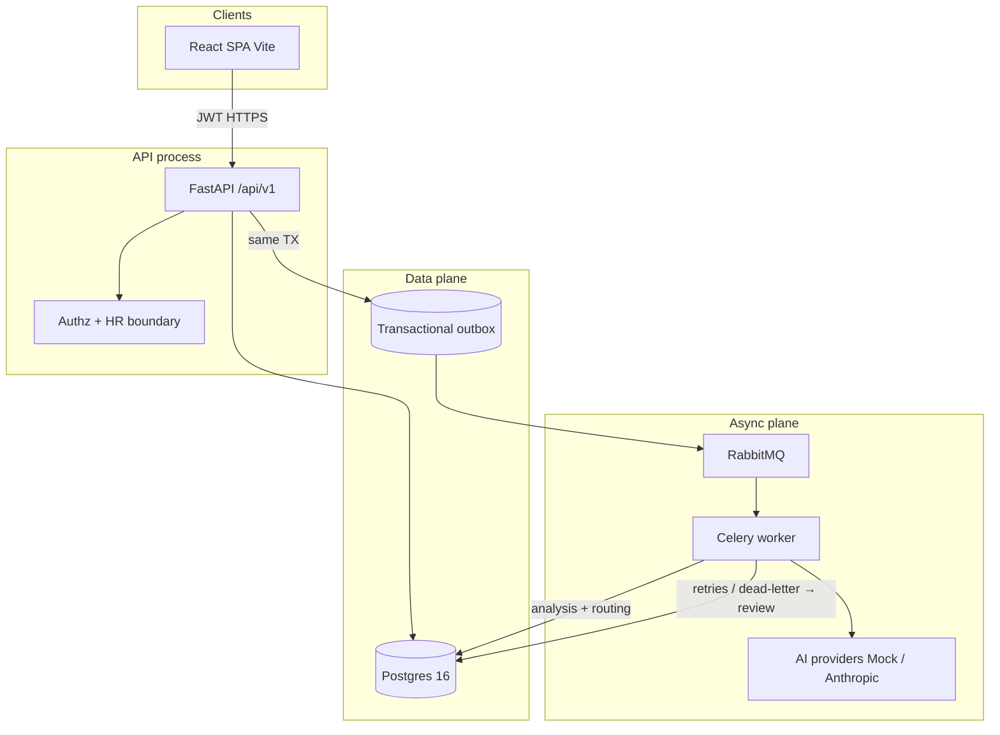
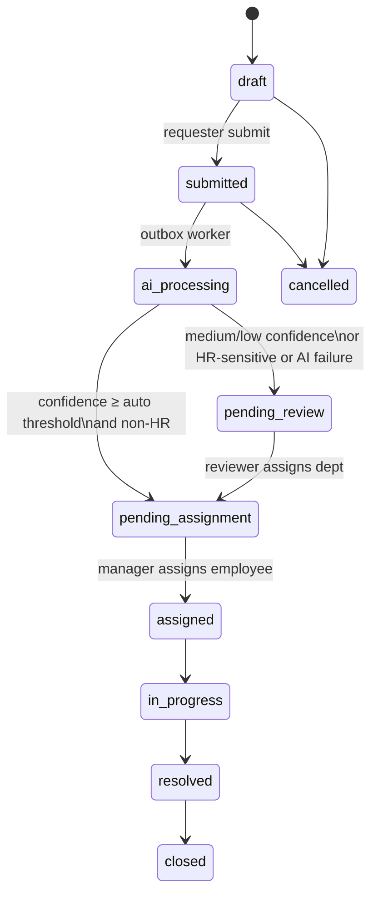

# AIBRM architecture

Modular monolith: FastAPI API + Celery workers + React SPA + Postgres + RabbitMQ.

## Request lifecycle (happy path)

## Security boundary (Phase 5)

- Non-HR requests: requester, department manager (same dept), reviewers (pending_review), admins.
- HR-sensitive / highly confidential: **requester**, **HR role**, or **HRCaseAccess** grant only. Admins do **not** auto-receive HR content.
- `HRCaseNotes` are separate resources; requesters get 403 on notes.

## Reliability

- Submit enqueues `OutboxMessage` in the same DB transaction as the request.
- Celery consumes `request.submitted` → AI analysis → confidence routing.
- Retries with exponential backoff; exhausted attempts → manual review queue (never drop the request).
- Default `AI_PROVIDER=mock` so the system runs without Anthropic credentials.
